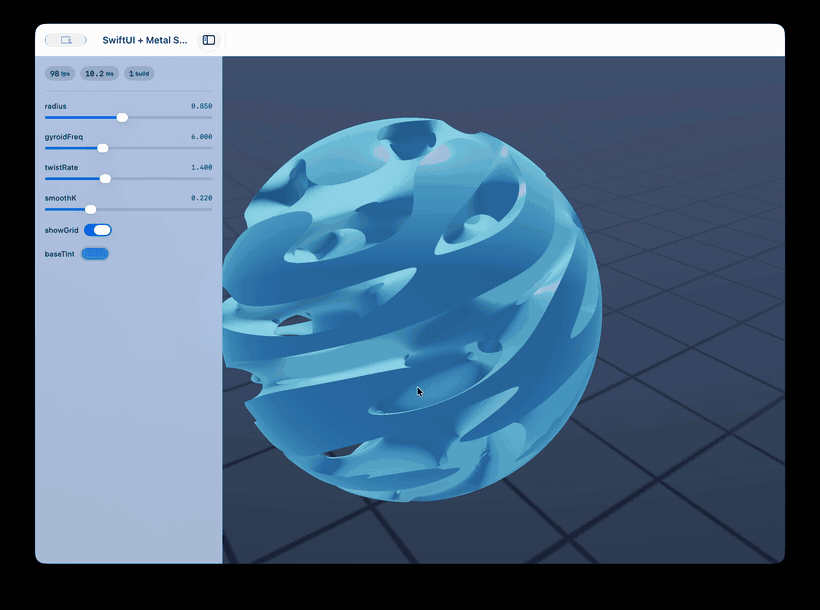

# arturo-swift


**A live SDF studio: Arturo describes the shader, SwiftUI and Metal render it.**

`scene.art` describes a signed distance field in a small Arturo dialect. The runtime lowers it to Metal with symbolic gradients, and a native SwiftUI shell renders it at display refresh rate while every control stays interactive.



## Highlights

- **Live modeling** from a compact DSL of primitives, domain transforms, and smooth blends.
- **Analytical normals** produced by a symbolic forward-mode autodiff pass. No finite differences on the hot path.
- **Hot reload** that recompiles the Metal shader when the watched sketch changes, without restarting the app.
- **Native controls** generated from the sketch: sliders, toggles, and color pickers, plus FPS, frame time, and build time metrics.
- **Errors stay on screen.** A failed edit shows its diagnostics in an overlay and leaves the last working shader rendering.
- **One-command packaging** into a double-clickable macOS app.

## Requirements

- macOS 14 or newer on Apple Silicon
- Swift 6 toolchain (Xcode or the command line tools)
- [Arturo](https://arturo-lang.io) 0.10 via Homebrew

```sh
brew install arturo
```

## Run it

```sh
brew install arturo

make          # build libswift_studio.dylib
make run      # open the studio
```

To build a standalone app:

```sh
make bundle
open "dist/SDF Studio.app"
```

Drag in the viewport to orbit the camera. Release to resume the idle turntable.

## Writing a scene

The demo scene is 15 lines:

```arturo
import "studio.art"!

studio .width:1200 .height:780 .watch:"scene.art" "SwiftUI + Metal Symbolic SDF Studio" [
    slider 'radius     0.3..1.5   0.85
    slider 'gyroidFreq 2.0..14.0  6.0
    slider 'twistRate  0.0..4.0   1.4
    slider 'smoothK    0.02..0.8  0.22
    toggle 'showGrid   true
    color  'baseTint   #3399ff
    sdf .analytical [
        smin [sphere [twist p twistRate] radius]
             [gyroid [twist p twistRate] gyroidFreq]
             smoothK
    ]
]
```

Controls are declared first and become slots in the 56-float uniform block:

| Form | Meaning |
| --- | --- |
| `slider 'name min..max default` | Float control bound to one slot |
| `toggle 'name default` | Boolean control, stored as 0 or 1 |
| `color 'name #rrggbb` | Color control occupying three consecutive slots |

The `sdf` block is a tree of nodes. `p` is the point being shaded, and transforms wrap the subtree below them.

| Node | Meaning |
| --- | --- |
| `sphere [p] radius` | Sphere |
| `box [p] hx hy hz` | Axis-aligned box with half extents |
| `torus [p] R r` | Torus around the Y axis |
| `gyroid [p] frequency` | Gyroid surface, bounded to a sphere |
| `twist [p] rate` | Rotate around Y by `rate * y` |
| `repeat [p] cx cy cz` | Domain repetition with the given cell size |
| `translate [p] x y z` | Offset the domain |
| `smin A B k` | Polynomial smooth minimum |
| `smax A B k` | Polynomial smooth maximum |
| `union A B` | Hard union |

Transforms nest in the order written, so `[twist [translate p 0 1 0] rate]` translates first and twists the translated space.

## Hot reload

With `.watch:"scene.art"`, the studio polls the sketch and reloads it whenever the contents change:

1. The new sketch is evaluated. Sliders, toggles, and colors are rebuilt.
2. The SDF tree is lowered to MSL and compiled.
3. Control values are preserved by name, so an edit keeps the current look. New controls start at their defaults.
4. If parsing or compilation fails, the error is shown in the overlay while the previous pipeline keeps drawing.

Each successful shader rebuild updates the build-time pill. A failed one shows the diagnostic text and leaves the previous shader running.

## How it works

```
scene.art ──► studio.art ──► Metal source ──► makeLibrary(source:)
                   │                               │
                   └──── controls ──► UniformPayload ──► fragment shader
```

`studio.art` walks the SDF tree and emits one function per node:

```metal
float map_7(float3 p, thread float3 &g, constant UniformPayload &u);
```

Each node returns its distance and writes its gradient into `g`. Point transforms accumulate a Jacobian as they descend, and the child gradient is transported back through it with `transpose(J)`. Smooth blends use the same factor for the distance and the gradient, so the field and its normal stay consistent. Sphere, box, torus, and gyroid each have a closed-form gradient.

The host compiles the generated source at runtime and uploads uniforms in a 256-byte payload: eight frame values (time, delta time, size, mouse, frame index) followed by 56 parameter floats.

SwiftUI and AppKit are driven from Arturo through a C ABI. `studio_step` pumps the event queue and draws one frame, returning 0 once the window closes. Because Arturo's `call.external` supports at most two arguments, the library also exports packed variants such as `studio_add_slider_p`, which take `slot` plus a `|`-separated spec string. The host pins itself with `RTLD_NODELETE` so the runtime survives Arturo's `dlclose` after each call.

## C ABI

| Export | Purpose |
| --- | --- |
| `studio_init(title, width, height)` | Create and show the window |
| `studio_begin_Spec()` | Reset the control list before a spec pass |
| `studio_add_slider(slot, name, min, max, default)` | Slider backed by `params[slot]` |
| `studio_add_toggle(slot, name, default)` | Toggle backed by `params[slot]` |
| `studio_add_color(slotR, name, r, g, b)` | Color backed by `params[slotR...slotR+2]` |
| `studio_compile_msl(source)` | Compile a shader, retaining the previous pipeline on failure |
| `studio_step()` | Pump events and render one frame |

Diagnostics are reported through `studio_report_error` and cleared with `studio_clear_error`.

## Project layout

```
studio_host.swift   SwiftUI shell, Metal renderer, C ABI
studio.art          DSL runtime, symbolically differentiated MSL generator
scene.art           Demo sketch
bundle.art          Packs the sketch and dylib into dist/SDF Studio.app
Makefile            Build, run, bundle, clean
```

## Limits

- The Makefile targets `arm64-apple-macos14.0`. Intel Macs need a different target and a Metal cap check.
- 56 parameter slots in total. A color consumes three.
- Gradient selection falls back to central differences when a blended gradient degenerates, which only happens at rare seam points.
- Control identity is the control name. Renaming a control during hot reload creates a fresh slot at its default.
- Built and tested against Arturo 0.10.0 and Swift 6.4.

## License

MIT. See [LICENSE](LICENSE).
